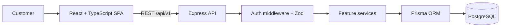

# System architecture

The browser uses TanStack Query for server state and a same-origin-configurable API client. Authentication uses an HttpOnly cookie. The server owns validation, recommendation scoring and financial-style arithmetic; client calculations are display-only helpers.
